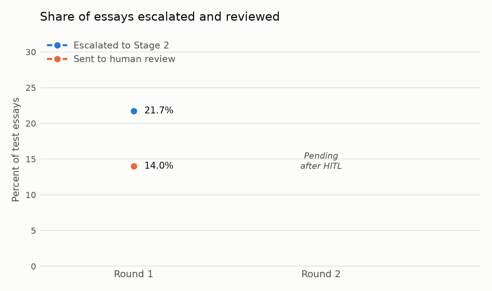
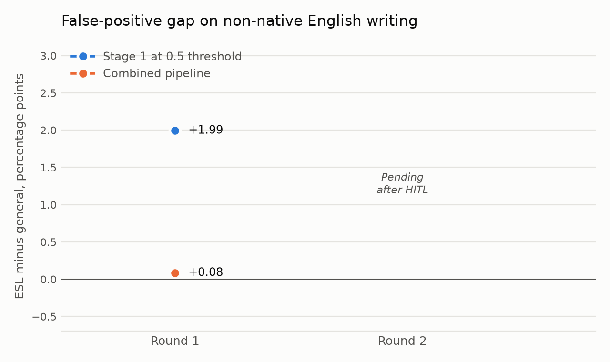
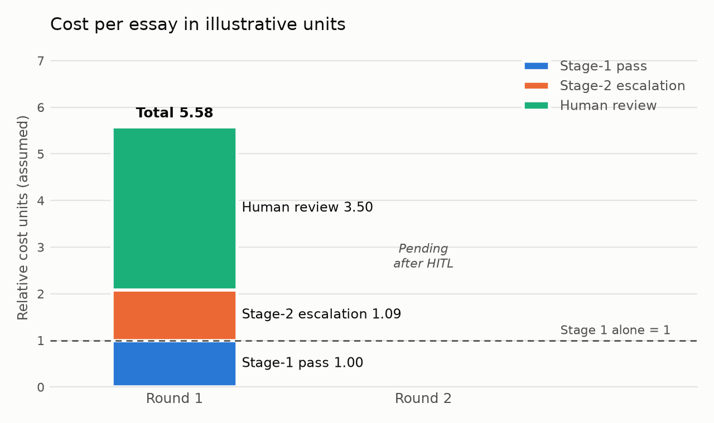

# AI-Generated Text Detection Flywheel

A two-stage detector for AI-written student essays, built as a triage tool for teachers. A fast stylometric model clears or flags the clear cases and passes the ambiguous ones to a fine-tuned small language model. A teacher reviews what the system flags, and those decisions, together with a new AI source, feed a second training round. Drift monitoring and a fairness check on non-native English writing run across every round.

It is a portfolio project that applies a production-style machine learning loop to academic-integrity triage. It is decision support and does not decide anything on its own.

**Status.** Round 1, the fairness check, the prompt-held-out evaluation and drift monitoring are done. Round 2 is built and tested, and it waits for the human review pass. Round-2 numbers below are marked TBD.

## Framing

This is a decision-support tool for teachers. It is not an automated accusation system. Every essay the system flags or escalates needs a human to confirm it before anyone acts. No code path, screen or message in this repo should imply an automatic verdict, and the section on ethics and limitations below explains why that matters.

## Problem

AI-text detectors are used on student work, and they get things wrong in ways that fall on real people. A false positive can cost a student their standing. Published work has shown that detectors flag writing by non-native English speakers more often. A useful system has to be fast on easy cases, spend expensive effort on hard ones, keep a person in the loop for anything consequential, report how often it is wrong and for whom, and notice when a new AI model starts to look different from the ones it learned.

## How it works

```
essay
  |
  v
Stage 1: 24 stylometric features -> XGBoost -> score
  |-- confident human  -> auto-clear (no action)
  |-- confident AI     -> auto-flag  (teacher must confirm)
  `-- ambiguous        -> Stage 2
                            |
                            v
        Stage 2: Qwen2.5-3B-Instruct with a LoRA adapter -> label and short rationale
                            |
                            v
        Review queue: every "AI-generated" verdict, plus the least confident
        "Human-written" verdicts -> teacher accepts, overturns, or tags a failure mode
                            |
                            v
        Round 2: new AI source + reviewed essays -> retrain both stages -> re-evaluate
```

**Stage 1** extracts 24 features: length, sentence-length variability, vocabulary diversity, a bigram burstiness proxy for perplexity, part-of-speech ratios, punctuation rates and three readability scores. An XGBoost classifier scores them. Thresholds are set on the validation split so about 20% of essays land in the ambiguous middle band.

**Stage 2** is Qwen2.5-3B-Instruct fine-tuned with LoRA on escalated training essays only, never the full dataset. It returns a label and a one-sentence rationale. The training rationale is a template built from the Stage-1 features that best support the true label. It is a heuristic cue for the teacher and not a verified explanation.

**The review queue** includes every "AI-generated" verdict, because skipping review there would be an automatic accusation. A confident "Human-written" verdict may skip review, since clearing takes no action against a student. The share of human verdicts still reviewed is calibrated on the validation split, and the test split only checks it.

**Round 2** adds one AI source that was held out of round 1 plus the reviewed essays, labeled with the reviewer's decision, then retrains both stages, recalibrates the thresholds and the review gate, and re-measures everything.

**Drift monitoring** compares each generation source with the training data using the Population Stability Index and the Kolmogorov-Smirnov statistic.

## Data, and two substitutions to be clear about

The essays come from the community DAIGT v2 dataset (human essays from the Persuade corpus plus AI essays from many models), downloaded from Kaggle. The non-native English fairness set is the ELLIPSE corpus of essays by English Language Learners in US schools.

The dataset has no timestamps. Each AI generation source stands in for a step in time, and two sources (`falcon_180b_v1` and `llama_70b_v1`) were held out of round 1 to play the part of a new model appearing later. This is a substitution. It is not real chronological drift.

The cost numbers are also illustrative. Each essay costs 1 unit for the Stage-1 pass, 5 units for each Stage-2 escalation and 25 units for each human review. These relative costs are assumptions, not financial data.

## Results, round 1

All numbers come from `results/` and are regenerated by the pipeline. Nothing here is rounded to look better. The test split has 6,099 essays after near-duplicates were removed.

**Stage 1 alone (test split)**

| Model | AUC-ROC | Precision | Recall | F1 |
|---|---|---|---|---|
| Logistic regression | 0.9828 | 0.8925 | 0.9389 | 0.9151 |
| XGBoost | 0.9921 | 0.9396 | 0.9581 | 0.9488 |

XGBoost is the Stage-1 decision model. Its escalation rate is 0.2172 on the test split.

**Stage 1 against Stage 1 plus Stage 2**

| | Accuracy | Precision | Recall | F1 |
|---|---|---|---|---|
| Stage 1 only, all test essays | 0.9611 | 0.9396 | 0.9581 | 0.9488 |
| Stage 1 plus Stage 2, all test essays | 0.9936 | 0.9921 | 0.9908 | 0.9915 |
| Stage 1 alone, escalated essays only | 0.8438 | 0.7784 | 0.8426 | 0.8092 |
| Stage 2, escalated essays only | 0.9932 | 0.9961 | 0.9866 | 0.9913 |

Stage 2 is much better than Stage 1 on the essays Stage 1 finds ambiguous. That 0.9932 is high enough that it was checked for leakage rather than accepted.

**Checking the 0.9932**

- Near-duplicate removal. Some human essays appeared in both train and the evaluation splits, and 297 test essays were removed. The headline metrics barely moved, so duplicates do not explain the result.
- A prompt-held-out evaluation. Three of the 15 essay prompts were held out of both stages, which were then retrained. On the held-out prompts Stage-2 accuracy on escalated essays was 0.9944, against 0.9931 on seen prompts, so the result is not prompt memorization.
- The same experiment shows where the system is weaker. On unseen prompts Stage 1 alone fell to 0.9280 accuracy from 0.9636, and the combined false-positive rate on human essays rose to 0.0087 from 0.0032. Most of those extra false positives were Stage-1 auto-flags that Stage 2 never saw. The counts are small, 6 of 692 human essays against 10 of 3,117, so the ratio is a rough estimate. This is one draw of three prompts.
- Why a language model reading the whole essay beats 24 summary features by this much is not fully explained.

**Fairness on non-native English writing**

False-positive rate on human-written essays, which are all false positives if flagged:

| Subgroup | Essays | FPR at 0.5 threshold | FPR, auto-flag only |
|---|---|---|---|
| General test, human essays | 3,809 | 0.0370 | 0.0042 |
| ELLIPSE (English Language Learners) | 5,936 | 0.0569 | 0.0047 |

The gap at the 0.5 threshold is +0.0199, which means Stage 1 flags non-native writing more often. The combined pipeline's gap is +0.0008. Auto-flagged essays are the ones that reach a teacher with a machine's suspicion attached, and that gap is +0.0005.

The fairness set needed correcting. Before near-duplicate removal, 546 of 6,482 ELLIPSE essays were already in Stage 1's training data, labeled human, which understated the gap. The earlier figure was +0.0176. The difference between the two figures is within sampling noise at this sample size.

**Review gate and cost**

The review gate sends 0.4168 of the human verdicts to review, calibrated on the validation split. It queues all 9 validation errors where Stage 2 said human and the essay was AI. On the test split it queued 7 of 7, a check that was not tuned on. Confidence gating cannot promise to catch every confident mistake, and one validation error came with very high confidence.







**Drift across generation sources**

Each source was compared with the round-1 training data. Feature-level drift flags nearly every source, because a single generator differs in style from the pooled mixture even when the models trained on it, so those flags do not separate a new source from an old one. The Stage-1 score and how essays are routed are more informative.

| Held-out source | Score PSI | Cleared with no review | Escalated |
|---|---|---|---|
| `llama_70b_v1` | 0.509 | 4.7% | 44.3% |
| `falcon_180b_v1` | 0.037 | 0.9% | 24.6% |

`llama_70b_v1` shifts Stage 1's behavior, with a major score PSI against a noise level of 0.015, and round 2 introduces it. `falcon_180b_v1` behaves like the seen sources and stays unseen in round 2 as a generalization test. See `results/drift_round1.md` for every source.

## Results, round 2

TBD. Round 2 needs the teacher's review pass. The pipeline, tests and the `round2` skill are ready. The table below fills in when `python -m evaluation.round2 report` runs.

| Metric | Round 1 | Round 2 |
|---|---|---|
| Escalation rate, test | 0.2172 | TBD |
| Stage 1 plus Stage 2 accuracy, test | 0.9936 | TBD |
| ESL false-positive gap, combined | 0.0008 | TBD |
| Cost per essay, illustrative units | 5.58 | TBD |

## Ethics and limitations

**This is decision support, and a human decides.** The system produces a suspicion and a rationale. A teacher who confirms a flag is making a judgment about a student, and the tool should never be the reason a student is accused. The review app shows Stage 2's suggestion next to each essay, and that can anchor a reviewer, so the suggestion helps triage and should not be read as evidence. The app hides the ground-truth label so reviewing is blind, which a real deployment would be as well.

**False positives have real consequences for students.** An essay flagged wrongly can lead to an accusation, a grade penalty or a disciplinary process, and the student then has to disprove a machine's guess. At the 0.5 threshold Stage 1 flags about 4% of human essays in the general test set and about 6% of ELLIPSE essays. The pipeline cuts those rates a great deal, but a rate that looks small becomes many students at scale, and the cases most at risk are the ones the system handles least well, such as unfamiliar topics and new AI models.

**The fairness evidence is a proxy, not a validated benchmark.** ELLIPSE covers 8th to 12th grade English Language Learners in US schools. It does not cover adult second-language writers, writers educated elsewhere, or the many other groups the concern applies to. The general comparison group probably includes some English-learner writers too, because ELLIPSE and the Persuade corpus overlap, so it is not a clean contrast. A small gap here does not show the system is fair to all non-native writers. The review app has an explicit tag for "possible false flag: non-native writing style" so teachers can record when it happens.

**The data is simulated.** Human essays are real student writing and the AI essays were generated from the same prompts by many models. Real use involves students who partly use AI, edit AI output, or write unusually, and none of that is measured here. A detector trained on these essays would meet a different distribution in a classroom.

**Results are measured on one dataset with one split.** The held-out prompts are one draw of three. The unseen generators are two sources used as a stand-in for the future. Several comparisons rest on small counts, and the intervals and counts are reported next to the numbers for that reason. Near-duplicate removal used an overlap cutoff, and light edits can stay under it. Mutation testing and coverage have not been run, and the model code, the review app and the entry points that write results have no automated tests.

**The Stage-2 rationale is not an explanation.** It is a templated cue that is consistent with the Stage-1 features. It tells a teacher which stylistic signals pointed one way, and it does not show what the language model used.

**Known issues.** The feature files hold two copies of the word and character counts, so the models use the preprocessing word count and not the feature function's own, which differs by about 1 to 2 percent. Results are consistent, and fixing it means retraining. The data, models and adapters are not in the repository, so results cannot be reproduced from it alone. The cost units are assumptions.

**Privacy.** Student essays are sensitive. The raw data, processed splits, review decisions and model files are kept out of git, and any real deployment would need consent, retention limits and an appeal process that this project does not provide.

## Reproducing

Python 3.11. The Stage-2 steps need an Apple-silicon machine or a GPU, and take hours.

```bash
python3 -m venv ghost && source ghost/bin/activate
pip install -r requirements.txt            # add requirements-dev.txt for the checks
python data/download.py                     # needs Kaggle credentials, see the script
python -m data.preprocess
python -m fairness.data_prep_esl
python -m data.dedup
python -m stage1.features train val test held_out esl_eval
python -m stage1.baseline_logreg && python -m stage1.baseline_xgb && python -m stage1.escalation_policy
python -m stage2.prepare_finetune_data && python -m stage2.finetune_lora
python -m stage2.infer --split test      # also val and esl_eval
python -m stage2.confidence val          # also test
python -m evaluation.evaluate && python -m evaluation.evaluate_combined
python -m stage2.build_review_queue
streamlit run hitl/review_app.py           # the teacher's review pass
python -m hitl.apply_corrections --source human
python -m drift.monitor
python -m viz.trend_plots
```

`make agent-check` runs the linter, the type checker, the fast tests and the style check. `make numbers` confirms every number in this README appears in `results/`.

## Repository layout

```
data/        download, preprocess, near-duplicate removal
stage1/      features, baselines, escalation bands
stage2/      fine-tuning data, LoRA training, inference, confidence, review queue
fairness/    ELLIPSE set and the false-positive check
evaluation/  metrics, combined evaluation, prompt-held-out, round 2
hitl/        the teacher review app and corrections
drift/       PSI and KS monitoring
viz/         trend plots
results/     generated tables and figures
docs/        the design spec and the decision log
tests/       synthetic-fixture tests
```

The design spec is `docs/SPEC.md` and the reasons behind each choice are in `docs/DECISIONS.md`.

## Built with Claude Code

This repo includes project instructions, hooks, reviewer agents and checks for Claude Code under `.claude/` and `scripts/agent/`. They keep the style checks, the protected evaluation files and the test gate enforced while Claude writes code. They are described in `docs/AGENT_WORKFLOW.md`.
